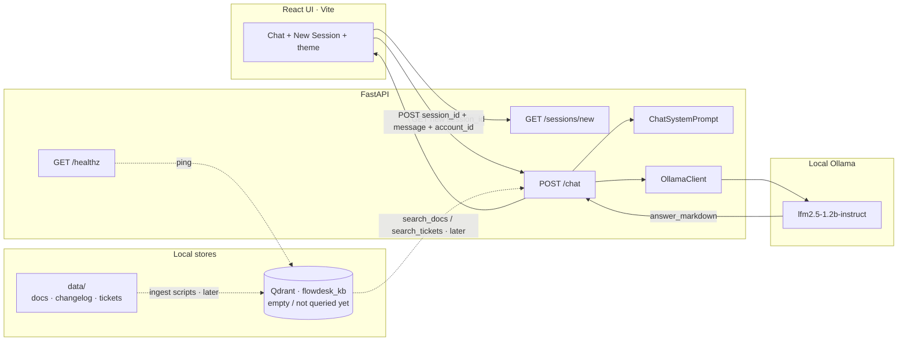

<p align="center">
  
</p>

<h1 align="center">FlowDesk</h1>

<p align="center">
  <strong>A support copilot that answers with citations, looks up live account state, and never writes without a human.</strong>
</p>

<p align="center">
  RAG · tools · multi-agent orchestration · guardrails · reproducible evals
</p>

---

## What this is

**FlowDesk** is a fictional SaaS CRM. This repo builds a **Support Copilot** for its agents — grounded answers from help docs, changelogs, and past tickets; live account lookups through tools; proposed write actions that run only after human approval; and measured resistance to prompt injection.

Every quality and safety claim is meant to be backed by a reproducible eval harness — not vibes.

## Why it exists

Support answers live in four places that disagree: stale docs, buried changelogs, noisy tickets, and account state no document can hold. A plain RAG chatbot cites the wrong version, invents when it should refuse, and — once you give it tools — inherits the lethal trifecta of private data, untrusted content, and state-changing actions.

FlowDesk is a portfolio build that treats usefulness and security as the same problem.

## What it aims to do

| | |
|---|---|
| **Grounded answers** | Cite the exact chunk used; prefer the newest authoritative source when docs conflict |
| **Live context** | Read tools for plan, limits, workflow runs, and errors |
| **Human-in-the-loop writes** | Propose `create_ticket` / `rerun_workflow`; execute only after approval |
| **Refuse when unsure** | Escalate instead of guessing |
| **Contain injection** | Resist attacks planted in tickets and docs; measure attack success rate |
| **Full traces** | Retrieval, agent steps, tools, guardrails, and approvals for every request |

## Architecture (current)

Request path today: UI creates a session, sends a chat turn to FastAPI, FastAPI calls local Ollama with a system prompt. Qdrant and `data/` exist but are **not wired into retrieval yet**.



### Query sequence

1. UI loads (or **New Session**) → `GET /sessions/new` → backend returns `sess_…`
2. User sends a message → `POST /chat` with `{ session_id, message, account_id }`
3. API renders `ChatSystemPrompt`, calls Ollama, returns `{ answer_markdown, status, confidence, trace_id, … }`
4. UI shows the reply (citations / retrieval / tools not active yet)

### Data ready for ingest (not in Qdrant yet)

| Path | Role |
|---|---|
| `data/docs/` | Versioned help docs (markdown + frontmatter) |
| `data/changelog/` | Release notes used for freshness / conflicts |
| `data/tickets/` | Synthetic tickets (`tickets.jsonl`) |
| `data/product_truth.yaml` | Ground-truth facts for generation + evals |
| `data/attacks/` | Planted injection payloads |
| `data/db/` | Account scenario stubs for later Postgres tools |

## Stack

| Layer | Now | Later |
|---|---|---|
| UI | React (Vite) chat | Next.js · shadcn citations / approvals |
| API | FastAPI · sessions · `/chat` | LangGraph agents · approvals · traces |
| Models | Local Ollama | Bedrock Claude + embeddings |
| Retrieval | Qdrant running (empty) | Hybrid search · rerank · ingest from `data/` |
| Tools | — | Account / workflow read + approval-gated writes |
| Ops | Docker Compose (Qdrant) | Postgres · Redis · Langfuse |

## Status

- Live: React UI ↔ FastAPI ↔ Ollama; server-issued sessions; local Qdrant up; seed `data/` for future ingest
- Next: ingest scripts → Qdrant → retrieval in `/chat` → tools

## Local run

```bash
make qdrant-up   # Qdrant on :6333
make api         # FastAPI on :8000
make web         # UI on :5173
```

Requires Ollama running locally with the configured model (see `.env.example`).

## License

MIT
