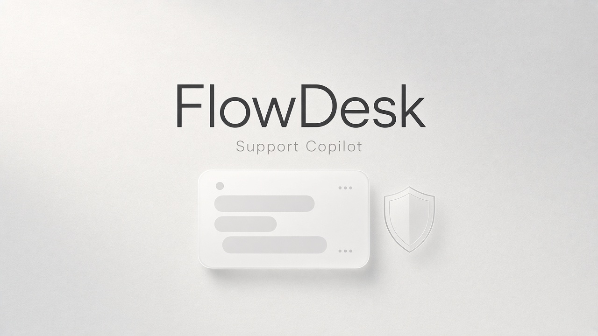

  

<h1 align="center">FlowDesk</h1>

  <strong>A support copilot that answers with citations, looks up live account state, and never writes without a human.</strong>

  RAG · tools · multi-agent orchestration · guardrails · reproducible evals

---

## What this is

**FlowDesk** is a fictional SaaS CRM. This repo builds a **Support Copilot** for its agents — grounded answers from help docs, changelogs, and past tickets; live account lookups through tools; proposed write actions that run only after human approval; and measured resistance to prompt injection.

Every quality and safety claim is meant to be backed by a reproducible eval harness — not vibes.

## Why it exists

Support answers live in four places that disagree: stale docs, buried changelogs, noisy tickets, and account state no document can hold. A plain RAG chatbot cites the wrong version, invents when it should refuse, and — once you give it tools — inherits the lethal trifecta of private data, untrusted content, and state-changing actions.

FlowDesk is a portfolio build that treats usefulness and security as the same problem.

## What it aims to do

| | |
|---|---|
| **Grounded answers** | Cite the exact chunk used; prefer the newest authoritative source when docs conflict |
| **Live context** | Read tools for plan, limits, workflow runs, and errors |
| **Human-in-the-loop writes** | Propose `create_ticket` / `rerun_workflow`; execute only after approval |
| **Refuse when unsure** | Escalate instead of guessing |
| **Contain injection** | Resist attacks planted in tickets and docs; measure attack success rate |
| **Full traces** | Retrieval, agent steps, tools, guardrails, and approvals for every request |

## Stack (planned)

| Layer | Choice |
|---|---|
| API | FastAPI · LangGraph · Postgres |
| Models | AWS Bedrock (Claude) · Titan embeddings |
| Retrieval | Qdrant (dense + sparse) · local reranker |
| Guardrails | Injection classifier · PII · output filters · approval gates |
| UI | Next.js · Tailwind · shadcn/ui |
| Eval | ~150 labelled cases · Promptfoo · CI smoke + full runs |
| Ops | Docker Compose · Langfuse |

## Status

Early scaffold. Product requirements stay local (not in this repo). Implementation follows milestones for data → retrieval → agents → guardrails → evals → UI.

## License

MIT — forthcoming with the first implementation commit.
